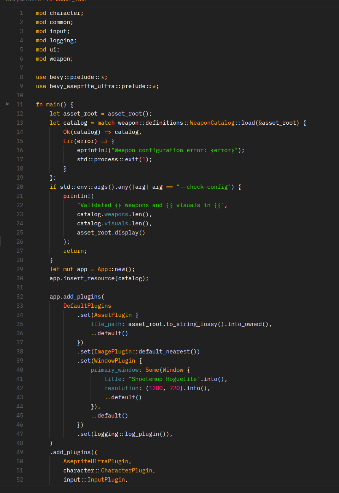

# Flat and Minimalistic for Zed

A [Zed](https://zed.dev) port of the **Flat and Minimalistic** JetBrains theme by Mat Cygert. It comes in two variants:

- **Flat and Minimalistic - Dark**: `#212121` background, yellow keywords, orange functions and types, green strings, pink numbers.
- **Flat and Minimalistic - Gray**: a flat light-gray theme with `#e8e8e8` background and a blue accent.



## Install

### From the extension registry

Open the Extensions panel (`Ctrl+Shift+X`), search for **Flat and Minimalistic**, and click **Install**.

### As a dev extension

1. Clone this repository.
2. In Zed, open the command palette (`Ctrl+Shift+P`) and run `zed: install dev extension`.
3. Select the cloned folder.

## Usage

Pick the theme with `theme selector: toggle` (`Ctrl+K Ctrl+T`), or set it in your settings:

```json
{
  "theme": "Flat and Minimalistic - Dark"
}
```

To follow the system appearance:

```json
{
  "theme": {
    "mode": "system",
    "light": "Flat and Minimalistic - Gray",
    "dark": "Flat and Minimalistic - Dark"
  }
}
```

## Credits

Colors are ported from the [Flat Minimalistic Theme](https://plugins.jetbrains.com/plugin/17749-flat-minimalistic-theme) for IntelliJ by Mat Cygert. This is an unofficial port.
